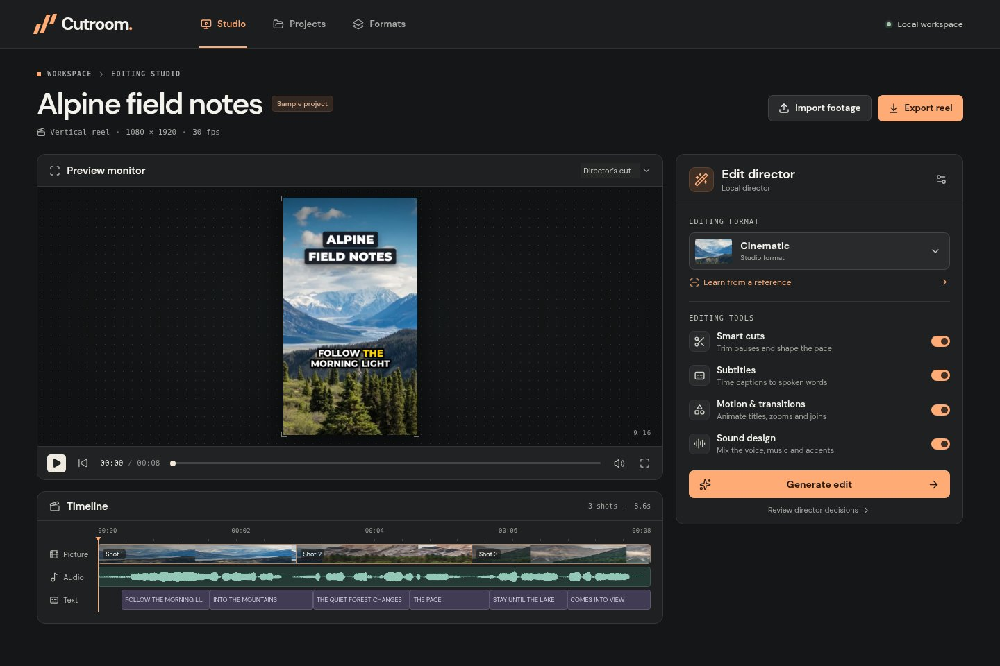

# Reels Editor · Cutroom

Cutroom turns uploaded footage into a finished vertical reel. Its director chooses cuts, zooms, animated titles, word-timed subtitles, transitions and a sound mix. Upload an edited reference to learn a reusable format, then apply it to new footage.

**[Watch the sample cut](assets/studio/sample-cut.mp4)** · **[Studio setup and workflow](docs/STUDIO.md)** · **[Claude Code director](.claude/agents/director.md)**



## Open the editor

Install Node 22.12 or later and FFmpeg with ffprobe, then run

```sh
npm ci
npm run editor
```

Open **http://localhost:4173**. Compare the finished sample with its source, or choose **Import footage** to start your own project. Under **Learn from a reference**, upload an edited example and save its format. Generate an edit, review the director’s choices and export the MP4.

Automatic speech recognition uses the Python dependencies in `requirements.txt`. You can also import an SRT file. The sample includes timed speech. The local director runs without a model account. **Director settings → Claude Code** uses your signed-in Claude CLI for editorial decisions.

## État

Phase 0 (socle) en place : CLI `reels new <slug>`, composition Remotion `Reel` vide (1080×1920, 30 fps), tests.

Phase 1 (faits) en place : `reels ingest`, `reels transcribe` (faster-whisper, à installer côté Python : voir `docs/ARCHITECTURE.md`), `reels analyze`, vérifiés sur un footage synthétique (`scripts/synthetic/`). Reste ouvert : l'horodatage des mots n'atteint pas ±0,05 s sur toute la parole enchaînée (environ un mot sur trois dans la tolérance, écart médian au début des mots 0,05 s) ; à mesurer sur un vrai tournage.

Phase 2 (premier Reel : coupes + sous-titres) en place : le contrat EDL (`src/edl/schema.ts`, `docs/EDL.md`), `resolve` et `validate` avec leurs tests, la composition Remotion (piste vidéo avec recadrage 9:16, punch-ins et zooms progressifs ; sous-titres mot à mot avec emphase, corrections et zone sûre), le brand kit par défaut (police Montserrat embarquée), et `reels validate`, `reels preview`, `reels render` (voix normalisée à −14 LUFS). Exemple de référence : `examples/demo/edl.json`, vérifié sur le footage synthétique par `scripts/synthetic/check-render.ts` (durée à l'image près, aucun mot coupé, son de chaque segment à 0 ms de sa place, synchronisation son/image conservée, cibles de cadrage à 1,1 px au plus de leur position prévue, sans bande noire). Limites : le mot surligné suit les bornes de mots de la phase 1, en moyenne 57 ms en avance sur la voix (jusqu'à 176 ms entre mots enchaînés) ; un mot de remplissage collé au mot suivant laisse 20 à 30 ms de sa fin. Les transitions, les overlays du catalogue, la musique et les effets sonores de la bibliothèque sont maintenant rendus. Pour `preview` et `render` sur une machine sans accès au téléchargement de Chrome, définir `REELS_BROWSER_EXECUTABLE`.

La suite se construit en suivant `docs/ROADMAP.md`.

## Utiliser Claude Code

Lire `CLAUDE.md` et `docs/DIRECTOR.md`. Pour une révision d’un montage du studio dans Claude Code, lancer `/review-edit <slug>`. Les commandes CLI existantes (`ingest`, `transcribe`, `analyze`, `validate`, `preview`, `render`) fonctionnent aussi sur ces projets.

## Documents

- `docs/ARCHITECTURE.md` : stack, pipeline, arborescence
- `docs/EDL.md` : format du fichier de montage
- `docs/DIRECTOR.md` : règles de montage du directeur
- `docs/ROADMAP.md` : phases de développement
