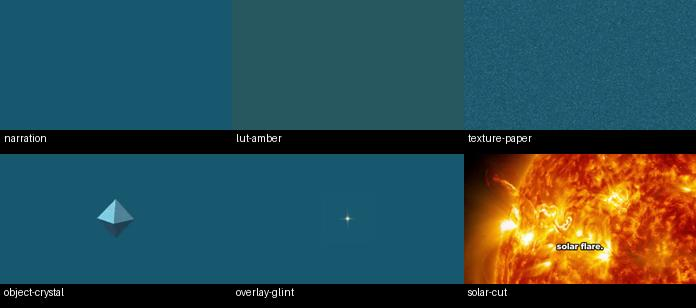

# Production assets and moving cutaways

The registry now contains working resources in all fifteen requested categories. The catalog includes four frame-resolved overlay motions and one moving stock clip. Search returns each asset’s implementation, license, compatible engines and preview. Automatic browser cutaways use literal subject matches in the retained speech, support supplied subtitles and respect existing rejection feedback.

In the rendered test, the narrator says “Today we observed a solar flare.” The director chose four-second NASA/SDO observational footage and used its first 2.5 seconds. It preserved the narration and restored the original picture after the phrase. An independent FFmpeg decode found movement between the first and second seconds and an exact match to the input picture at 4.8 seconds in the reduced-resolution check. The technical source is synthetic. [Narration](../examples/asset-library/narration.mp4) · [Rendered browser edit](../examples/asset-library/solar-cut.mp4) · [Timeline](../examples/asset-library/solar-cut.json)

The native media tool can apply four original resources by catalog ID over a selected time interval. The LUT grades an SDR image. The paper grain uses a transparent texture. The crystal ships as an editable OBJ with a fixed transparent turntable for compositing. The star glint is a transparent animated overlay. Each native render preserved audio and the original project file. On a six-second 320 × 180 clip, the four renders took 0.29 to 0.53 seconds each on the tested Linux CPU. Native import of arbitrary 3D scenes and user-directed relighting remain separate capabilities.

| Resource | Render |
| --- | --- |
| Amber print | [Graded video](../examples/asset-library/lut-amber.mp4) |
| Paper grain | [Textured video](../examples/asset-library/texture-paper.mp4) |
| Crystal turntable | [Composite](../examples/asset-library/object-crystal.mp4) |
| Star glint | [Overlay](../examples/asset-library/overlay-glint.mp4) |

Native tests exercise the ordinary MCP media operation and invalid intervals. The independent decoded pixel results measure each composite inside and after the selected range. [Pixel measurements](../examples/asset-library/pixel-checks.json) · [Asset notices](../assets/LICENSES.md)

In the web editor, **Browse editing assets** opens the catalog. Choose a category or search by subject. Each result includes a playable or visual preview, usage rights and its supported editor. A Chromium check opened all fifteen categories, loaded the previews and played the solar recording. The solar export was made with zero revision passes to isolate cutaway placement. Its report also retained three caption review flags.
